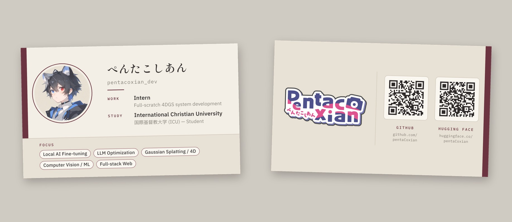

# Business card: ぺんたこしあん (pentacoxian_dev)



Double-sided card for offline meetups. Japanese standard size **91 × 55 mm** with a **3 mm bleed**.

| Side | Content |
|------|---------|
| Front | Avatar (head logo) · ぺんたこしあん / `pentacoxian_dev` · **WORK**: Intern, full-scratch 4DGS system development · **STUDY**: International Christian University (国際基督教大学), student · **FOCUS** tags: Local AI Fine-tuning, LLM Optimization, Gaussian Splatting / 4D, Computer Vision / ML, Full-stack Web |
| Back | PentacoXian wordmark logo · QR → `https://github.com/pentaCoxian` · QR → `https://huggingface.co/pentaCoxian` |

## Files

| File | Use it for |
|------|------------|
| `print/pentacoxian_card_print.pdf` | **Send this to the printer.** 2 pages (front, back), 97 × 61 mm including bleed, TrimBox/BleedBox set, fonts embedded. |
| `print/pentacoxian_card_print_trim-marks.pdf` | The same pages with Japanese-style trim marks (トンボ), for printers that ask for them. |
| `editable/front.svg`, `editable/back.svg` | **Illustrator**: open directly. 97 × 61 mm artboard with live text and vector QR codes. Groups: Background / Avatar / Text / Focus and Background / Logo / Divider / QR. |
| `editable/*_layers_350dpi.psd` | **Photoshop**: 1337 × 841 px at 350 dpi (with bleed). One raster layer per group, same names as above. |
| `preview/front.png`, `preview/back.png`, `preview/mockup.jpg` | Trimmed 350 dpi previews and a mockup, for sharing. Not for print. |
| `assets/` | Logo cut out on a transparent background, avatar with its backdrop toned to linen, and the original images in `assets/source/`. |
| `src/` | Scripts that regenerate everything (see below). |

## Layout specs

- Trim 91 × 55 mm · bleed 3 mm per side → document 97 × 61 mm
- Text and QR codes stay at least 4 mm inside the trim (QR right edge: 4.6 mm)
- The bordeaux edge bar is 2.4 mm wide on the card, so a small cutting drift doesn't show. It sits on the same physical edge on both sides (left on the front, right on the back).
- QR codes: version 3, 29 × 29 modules, about 0.5 mm per module, with at least 4 modules of light quiet zone. Both were decoded from the rendered print PDF.

## Palette

Desaturated: ivory and linen base, warm muted grays, and a single bordeaux accent.

| Token | Hex | Used for |
|-------|-----|----------|
| Ivory | `#F4EFE6` | Front background |
| Linen | `#E8E1D5` | Back background, focus band |
| Tile | `#FAF7F1` | QR tiles, focus tags |
| Line | `#D2C9BB` | Hairlines, tile borders |
| Muted gray | `#86807A` | Secondary text |
| Charcoal | `#3A3634` | Primary text |
| QR ink | `#2E2A2A` | QR modules |
| Bordeaux | `#6B3440` | Edge bar, labels, avatar ring |
| Bordeaux soft | `#A57A80` | Tag outlines |

The files are RGB. Every color sits comfortably inside the CMYK gamut. If you want to check before ordering, soft-proof in Illustrator (*View → Proof Setup → Japan Color 2001 Coated*). Matte or uncoated stock (マット紙, ヴァンヌーボ, etc.) suits the muted palette better than gloss.

## Fonts (all SIL Open Font License, free on Google Fonts)

- **Shippori Mincho B1** SemiBold: name
- **IBM Plex Sans JP** Regular / Medium / SemiBold: body text and tags
- **IBM Plex Mono** Regular / Medium: handle, labels, URLs

The print PDFs embed these fonts, so the printer doesn't need them. To edit the text in Illustrator, install the fonts first:
<https://fonts.google.com/specimen/Shippori+Mincho+B1>, <https://fonts.google.com/specimen/IBM+Plex+Sans+JP>, <https://fonts.google.com/specimen/IBM+Plex+Mono>

## Regenerating

The text, colors and links live at the top of `src/build_card.py` (`CONTENT`, `C`). Requirements: `pip install segno playwright pymupdf psd-tools opencv-python-headless pillow numpy`, a Chromium for Playwright, and the TTFs above in a folder (file names are listed in `FONT_FILES`).

```bash
python src/prep_assets.py assets/source assets
```

```bash
python src/build_card.py assets . --fonts /path/to/fonts
```

Set `CHROMIUM_PATH` if Playwright should use a specific Chromium binary.
